# Rust agent harness — design

**Status:** design only. No code yet. S1 is the next step.

## Context

The CS 329Z project needs a system whose evaluation is rigorous, and the harness is that system's core. Building it in Rust from scratch is the point: no framework, so the loop is yours to understand.

Standalone project. It shares nothing with the trading screener elsewhere in this workspace — that project is unrelated and must not be imported, called or designed around.

## How to read this

Each phase is one **functional requirement** — a capability the harness lacked — and each requirement exists because the previous phase fails at something. The arc is:

*a call → an act → a record → forgetting selectively → a bound → composition → extension.*

The eval rig is drawn beside the spine rather than on it: it is required by the deliverable, not forced by the phase before it.

Diagrams are cumulative. **Grey** blocks were built in an earlier phase and are unchanged; **green** blocks are new in this phase; **amber** marks an existing block whose *shape* changes.

Only S1–S3 have detailed diagrams. S4–S7 are stated as requirements, with their building blocks deliberately undesigned — they get diagrams when we reach them.

**Three phases are amber.** S3 extracts the loop's decisions so they can be replayed; S5 adds suspension to the driver; S6 makes it re-entrant. Each is a small, local change — but a change, and marking it is the honest drawing.

**There are no rebuild-from-scratch phases.** Every later phase is drawn as additions with, at most, one amber block.

---

## The arc

Read the arrows as **gaps** and the boxes as **capabilities**: each arrow names something the phase on its left cannot do, and that specific inability is what makes the next phase necessary. So the first arrow says "S2 exists because S1 cannot produce an answer that depends on an action."

It is not a schedule. The phases cannot usefully be reordered or skipped — each removes a limitation that blocks real work at the phase before it.

*Source: [diagrams/arc.mmd](diagrams/arc.mmd)*

| Gap the arrow names | In plain terms |
|---|---|
| S1 cannot produce an answer that depends on an action | If the task needs a file read or a command run, the reply depends on something that doesn't exist yet. One call cannot do it. |
| S2 leaves no record of a run | When a run goes wrong at turn nine there is nothing to inspect afterwards — state was in memory, the model is non-deterministic — so you re-run and hope. |
| S3's history outgrows the window | Every turn kept in the prompt eventually exceeds the model's context, and quality degrades before the hard limit. |
| S4 cannot stop a tool from doing damage | Once the loop is reliable enough to leave running, the risk stops being "does it work" and becomes "what if it overwrites something". |
| S5 can only forget, and only globally | Compaction throws away old detail uniformly; it cannot scope a sub-problem into its own context and return just the conclusion. And with no way to discover a procedure on demand, every procedure has to sit in the prompt at once. |
| S6 still needs a rebuild per tool | Tools are compiled in, so a new capability means editing Rust, rebuilding, and shipping. |
| *(side track)* the eval rig needs a record | Not a gap in any phase — a gap in the evidence, present from S1 onward. Its prerequisite is S3's record, which is why it hangs off S3 and not off the last phase. |

---

## S1 — one prompt in, one answer out, cost known

**Requirement.** Send a prompt to a model, get a reply, report the token usage.

**Why.** Everything after assumes a reliable round trip with typed messages and a known cost. Without usage numbers there is no budget, and without a budget the S2 loop cannot be stopped.

**Required.** A request/response shape the rest of the code can hold; credentials from the environment with a provider-neutral base URL and model; one HTTP call; one error path; a surface that prints the answer and the cost.

**Absent on purpose:** memory, tools, loops, retries, logging.

**Where the envelope lives.** `Request` says what is asked; the adapter says how to say it — field names, the temperature constant, and whatever headers a gateway demands to be talked to at all. Provider quirks stay out of the domain, which is why `Request` has no `body()` and the wire shape is private to the client.

*Source: [diagrams/s1-call.mmd](diagrams/s1-call.mmd)*

The same path as data, showing where the domain stops and the adapter begins:

*Source: [diagrams/s1-dataflow.mmd](diagrams/s1-dataflow.mmd)*

---

## S2 — the model acts, observes, continues

**Requirement.** Let the model request an action, see the result, and continue until it answers or exhausts its turns.

**Why.** At S1 the model can only talk. The moment it can ask for a file to be read, one round trip is not enough — the next reply depends on a result that does not exist yet. That is what makes it an agent, and it needs a loop.

**Required.** A tool contract (name, description, argument shape, execution) whose argument shape is machine-readable, because it is sent to the model as the calling convention; a dispatcher; the loop; a turn ceiling; and bounded results — a command that prints megabytes will blow the next request's budget and bury the useful line, so shaping is a requirement of the loop, not a nicety.

**Two seams that cost nothing now.** One chokepoint for every action, and results kept whole with a shaped copy sent. S5 and S4 attach to those instead of rewriting tools and record formats. Drawing the seams is not forward-looking scaffolding; it is the difference between a dispatcher and four tools each doing their own thing.

*Source: [diagrams/s2-tools.mmd](diagrams/s2-tools.mmd)*

---

## S3 — explain and reproduce any run, offline

**Requirement.** Re-drive a past run from its record, with no network, and get the same transcript and the same spend.

**Why.** At S2 a run is a live side effect. When it misbehaves at turn nine you cannot go back and look — the state was in memory and the model is non-deterministic — so debugging means re-running and hoping. The record is also the thing the course grades: no record, no evaluation.

**Required.** An append-only record of every turn, holding enough to reconstruct the next decision; a replay path that re-drives the same decisions with the model and tools stubbed; a budget denominated in money, because a loop can be cheap per turn and ruinous in total; and a repetition guard, because identical action followed by identical result means stuck, and a turn ceiling will not catch it before the budget is gone.

**This is the first amber phase.** Replay requires the loop's decisions to be available without performing them, so the S2 loop body splits into a pure "what next" and an async "do it". Localised, but not free.

*Source: [diagrams/s3-record.mmd](diagrams/s3-record.mmd)*

**Done looks like:** a task runs, the log is noted, the network is disconnected, the log replays to an identical transcript and identical spend; then `inspect` shows the turn where it went wrong.

S1–S3 is the minimum "I understand harnesses" set.

---

## S4 — keep a long task inside the window

**Requirement.** A task that outlives the model's context still finishes coherently.

**Why.** The S3 record grows monotonically; eventually every request is too large, and quality degrades well before the hard limit. The record cannot be truncated because S3 needs it — so the prompt must become a *projection* of the record, with a rule for what falls out and what stands in for it.

**Required.** A projection from record to prompt (seeded at S2 by keeping results whole), a trigger, and a policy for eliding or summarising. Rule-based first, model-summarised second: rules are cheaper to debug.

*Building blocks not designed yet.*

## S5 — bound what the agent may do unasked

**Requirement.** No side-effecting action happens unless policy allows it; an action needing approval can pause and resume.

**Why.** The tools write and execute. Once the loop is trustworthy enough to leave running, the risk moves from correctness to blast radius.

**Required.** The S2 chokepoint becomes policy-aware; a suspension state that can be persisted and resumed; a filesystem boundary. **Expected amber on the driver**, which gains a stop-mid-run path. Permissions must not live inside individual tools — that is why the chokepoint existed from the start.

*Building blocks not designed yet.*

## S6 — compose

**Requirement.** Sub-tasks run without contaminating the main context, reusable procedures load on demand, and a task suite can be run and graded.

**Why.** S4 gave you forgetting, but forgetting is blunt and global: compaction drops old detail uniformly, whether or not the task still needs it. A long task contains self-contained sub-problems — explore this directory, debug that failing test — whose intermediate work matters to *them* and is noise to the main thread. What's missing is scoping, not forgetting. The same shape applies to procedures: with nothing that a model can look up on demand, everything it might ever need has to be carried in the prompt simultaneously, which both costs tokens and dilutes attention.

**Required.** An isolation boundary returning a summary rather than a transcript; a procedure file the model discovers rather than carries. **Expected amber on the driver**, which becomes re-entrant.

*Building blocks not designed yet.*

## S7 — extend without rebuilding

**Requirement.** New tools arrive over a protocol rather than as compiled-in code.

**Why.** S2's tools are compiled in, so every new capability means editing Rust and shipping a release. Nothing about the tool contract requires that — a name, a description and a schema can be delivered at runtime just as easily as at compile time.

**Required.** A protocol client, and a projection from remote tools into S2's contract. If S2's contract was drawn well, nothing else changes.

*Building blocks not designed yet.*

---

## The eval rig — a parallel track, not a phase

**Requirement.** Run the harness over a set of tasks, grade the results, and compare against a weaker configuration.

**Why it is not on the spine.** Every other box is forced by an inability of the phase before it. This one isn't: you couldn't prove anything at S1 either, so nothing about S5 in particular makes it necessary. It's forced by the deliverable — the course grades evaluation, and Results are the largest single block of the report. What it *does* depend on is a record to grade, which is why it hangs off S3 rather than off the last phase.

**Why it can't wait until the end.** The harness is worth measuring as soon as it can be run twice. A rig built at the end measures whatever the harness happens to have become; a rig built early changes what you decide to build next.

**Required.** A task suite with fixed inputs and recorded outcomes; a grader; and at least one weaker baseline, so a rising tide doesn't read as skill. Task and grader design are not done yet.

*Building blocks not designed yet.*

---

## Cross-phase decisions

Cheap now, expensive later.

1. **The record is the state.** Transcript, turn count and spend are derived from it. A mutable transcript plus a separate log gives two sources of truth, and replay drifts.
2. **Tool failure is an observation; transport failure is an error.** A tool that times out must be seen by the model as a result it can react to; a 502 must abort the run. Never convert one into the other.
3. **One chokepoint for execution.** Every action passes through one function that validates, checks permission, runs, shapes and records. S3's recording and S5's permissions attach to that seam rather than being retrofitted into each tool.

## Toolchain

- Installed: rustc/cargo 1.77.2 (March 2024) plus nightly. Run `rustup update stable` first; pin `edition = "2021"`, since edition 2024 needs 1.85.
- The directory is not currently a git repository; `git init` here when code begins.

## Model access

OpenAI-compatible HTTP. `LLM_API_KEY` → `DEEPSEEK_API_KEY` → `OPENAI_API_KEY`; base URL from `LLM_BASE_URL` (default `https://api.deepseek.com/v1`); model from `LLM_MODEL` (default `deepseek-chat`).

Tool-calling quality is model-dependent. A weak model produces malformed calls, which usefully exercises the error path but slows development; the client stays provider-neutral so a stronger endpoint is an environment variable away.

## Verification, per phase

- **S1:** one prompt, one reply, tokens reported, exit 0.
- **S2:** a file round trip in three turns; a forced one-turn ceiling halts cleanly; a megabyte of command output is elided, not sent.
- **S3:** replay a recorded run with the network down; transcript and spend identical.

Unit tests target the pure parts — the reducer, the decision function, the stuck detector, shaping — with no network and no key.
