# S1 — one prompt in, one answer out, cost known

**Status:** built, 2026-11-16

[← design index](../DESIGN.md)

**Requirement.** Send a prompt to a model, get a reply, report the token usage.

**Why.** Everything after assumes a reliable round trip with typed messages and a known cost. Without usage numbers there is no budget, and without a budget the S2 loop cannot be stopped.

**Required.** A request/response shape the rest of the code can hold; credentials from the environment with a provider-neutral base URL and model; one HTTP call; one error path; a surface that prints the answer and the cost.

**Absent on purpose:** memory, tools, loops, retries, logging.

**Where the envelope lives.** `Request` says what is asked; the adapter says how to say it — field names, the temperature constant, and whatever headers a gateway demands to be talked to at all. Provider quirks stay out of the domain, which is why `Request` has no `body()` and the wire shape is private to the client.

## The system at this phase

*Source: [diagrams/p1-structs.mmd](../diagrams/p1-structs.mmd). Grey is built and unchanged; green is new in this phase; amber is an existing block whose shape changed; a red dotted edge is a connection the phase removes.*

All of it is green, because all of it is new: `main` parses, builds and prints, the `Client` owns the one POST, and the provider is the only box that is not ours.

The same path as data, showing where the domain stops and the adapter begins:

*Source: [diagrams/s1-dataflow.mmd](../diagrams/s1-dataflow.mmd)*

---

## How it is checked

**S1:** one prompt, one reply, tokens reported, exit 0. *Met live: `ok`, 44 in · 13 out.*
