# S2 — the model acts, observes, continues

**Status:** built, 2026-11-16

[← design index](../DESIGN.md)


**Requirement.** Let the model request an action, see the result, and continue until it answers or exhausts its turns.

**Why.** At S1 the model can only talk. The moment it can ask for a file to be read, one round trip is not enough — the next reply depends on a result that does not exist yet. That is what makes it an agent, and it needs a loop.

**Required.** A tool contract (name, description, argument shape, execution) whose argument shape is machine-readable, because it is sent to the model as the calling convention; a dispatcher; the loop; a turn ceiling; and bounded results — a command that prints megabytes will blow the next request's budget and bury the useful line, so shaping is a requirement of the loop, not a nicety.

**Two seams that cost nothing now.** One chokepoint for every action, and results kept whole with a shaped copy sent. S5 and S4 attach to those instead of rewriting tools and record formats. Drawing the seams is not forward-looking scaffolding; it is the difference between a dispatcher and four tools each doing their own thing.

### What the wire forces — amended after walking a read-file exchange

S1's types assumed a conversation made of plain text. A tool turn is not that. Four shapes travel under one `role` field:

| Message | Fields present |
|---|---|
| `system` | `content` |
| `user` | `content` |
| `assistant`, when calling | `content: null`, `tool_calls: [...]` |
| `tool` | `content`, `tool_call_id`, `name` |

So `Message` becomes an enum, and the impossible state — an assistant message with neither text nor calls — stops being representable:

```rust
pub enum Message {
    System(String),
    User(String),
    Assistant { text: Option<String>, calls: Vec<ToolCall> },
    Tool { call_id: String, name: String, content: String },
}
```

**`Reply` must stop requiring text.** S1 rejects a reply with no `content`, which is correct when every reply is an answer and wrong here: a tool-calling reply carries `"content": null`. Left alone, that check turns every tool turn into `NoContent` and the loop never starts. The rule becomes **text or calls, never neither**, and `Reply` gains `calls: Vec<ToolCall>`.

**Two parse boundaries, not one.** The body is parsed once where it enters. Each `tool_call.function.arguments` is then a *string containing JSON*, parsed a second time into that tool's argument type. Only the first parse is fatal — it means the provider broke its own contract. A failure at the second becomes an observation the model can correct (`tool_error: arguments are not valid JSON: …`), because a malformed call is a behaviour to recover from, not a reason to abort a run.

**A turn may carry several calls.** One model call can return N calls; each yields its own `role: "tool"` message keyed by `tool_call_id`, then a single further call. The id is the only thing linking a result to its question.

**The loop decides on "are there calls?", not on `finish_reason`.** Providers disagree on that field's value when calls are present; presence of calls is what the message says.

**The turn ceiling counts model calls**, not tool executions — otherwise a batch of four calls consumes four turns and the ceiling stops meaning what it says.

**Usage accumulates.** S1 reports one call's price; S2 reports a run's, summed over every call the loop makes.

Three files change: `request.rs` (`Message` becomes an enum and absorbs `Role`), `reply.rs` (carries calls; `NoContent` becomes `Empty`, meaning neither text nor calls), and a new tool module for the contract and the chokepoint. `config.rs`, the transport in `client.rs` and the shape of `main.rs` do not.



*Source: [diagrams/s2-tools.mmd](../diagrams/s2-tools.mmd)*

**Built** *(2026-11-16)*. The contract, the four tools, the chokepoint and the loop, plus the registry edge into the client that the diagram now shows. Where the implementation departs from the paragraphs above:

- the ceiling defaults to **8 model calls** (`--max-turns N`), and the workspace defaults to the current directory (`--workspace DIR`)
- arguments are validated by deserialising into the tool's `Args`, so a shape mismatch is an observation in the same way bad JSON is — one rule, not two
- an observation is shaped to **8 KiB**, head and tail kept with the elided count stated; the full text never leaves the tool, which is what makes S3's "keep results whole" a record concern rather than a memory one
- **`bash` is not sandboxed.** `read_file`, `write_file` and `list_dir` resolve paths lexically and refuse `..` and absolute paths, but a shell can leave the root. Bounding it is S5's job
- **no retries.** A transport failure still ends the run; retry policy needs the budget S3 introduces

Live evidence: the model created `greeting.txt`, read it back and answered in three turns (2,532 in · 113 out), and `--max-turns 1` halted after one call with the spend reported.

## How it is checked

**S2:** a file round trip in three turns; a forced one-turn ceiling halts cleanly; a megabyte of command output is elided, not sent; a tool-calling reply with `content: null` is accepted; a malformed `arguments` string comes back as an observation rather than an abort. *Met: the round trip and the ceiling live; the rest by test — a 20 KB observation arrives under 5 KB on the wire.*
