# S3 — explain and reproduce any run, offline

**Status:** built, 2026-11-16

[← design index](../DESIGN.md)

**Requirement.** Re-drive a past run from its record, with no network, and get the same transcript and the same spend.

**Why.** At S2 a run is a live side effect. When it misbehaves at turn nine you cannot go back and look — the state was in memory and the model is non-deterministic — so debugging means re-running and hoping. The record is also the thing the course grades: no record, no evaluation.

**Required.** An append-only record of every turn, holding enough to reconstruct the next decision; a replay path that re-drives the same decisions with the model and tools stubbed; a budget denominated in money, because a loop can be cheap per turn and ruinous in total; and a repetition guard, because identical action followed by identical result means stuck, and a turn ceiling will not catch it before the budget is gone.

**This is the first amber phase.** Replay requires the loop's decisions to be available without performing them, so the S2 loop body splits into a pure "what next" and an async "do it". Localised, but not free.

## The system at this phase

*Source: [diagrams/p3-structs.mmd](../diagrams/p3-structs.mmd). Grey is built and unchanged; green is new in this phase; amber is an existing block whose shape changed; a red dotted edge is a connection the phase removes.*

Grey is S1 and S2 unchanged. Green adds `Log` and `replay()`. Amber is `agent::run`, which keeps its job but changes shape: the S2 loop body splits into a pure `decide()` and an async driver, so a recorded reply can be judged without being performed. The **plain dotted** edge is that borrow — `replay()` calls the loop's judgement, not the loop. Red dotted is reserved for an edge a phase removes; none is removed here.

**Done looks like:** a task runs, the log is noted, the network is disconnected, the log replays to an identical transcript and identical spend; then `inspect` shows the turn where it went wrong.

**Built** *(2026-11-16)*. The record, replay, the money budget and the stuck detector.

- **Record**: one JSON object per line, flushed per event, so a run that dies at turn nine leaves nine turns. The loop takes a `Recorder`, so it never branches on whether it is being kept. It lives at `~/.harness/runs` by default — outside the workspace, because a record the tools can reach is not an audit trail; a `--log` inside the workspace is warned about rather than refused.
- **Replay**: rebuilds each reply from the record, runs it through the same `decide` the live loop uses, and checks the recorded effects match — the right tools, in the right order, ending in the same answer and the same turn count. It calls nothing and touches nothing.
- **Budget**: `--max-usd`, priced from `LLM_PRICE_IN` and `LLM_PRICE_OUT` (dollars per million tokens, both or neither). Checked *before* acting, so passing the budget does not also run tools.
- **Stuck**: the same call, arguments and result `--stuck-after` times in a row (default 3, 0 disables) ends the run. Whole turns are compared, so a model alternating between two states is not caught — a known limit.

Two gaps worth naming. Replay re-derives the *decisions* but not the *reason* a run halted: a budget or stuck stop is recorded with its reason and replayed by turn count alone, because recomputing it would need the limits and prices. And `inspect`, promised above, does not exist — the record is JSONL and greppable, which is not the same thing.

Live evidence: a three-turn run recorded eight events and replayed offline — provider settings removed from the environment — to the same answer and the same 2,605 in · 142 out. A run with `--max-usd 0.000001` stopped after its first call: `spent $0.000236 of a $0.000001 budget`, record written, exit 1.

S1–S3 is the minimum "I understand harnesses" set.

---

## How it is checked

**S3:** replay a recorded run with the network down; transcript and spend identical. *Met, plus the ceiling, the money budget and the stuck detector each end a run with a recorded reason.*
