# S4 — keep a long task inside the window

**Status:** built, 2026-11-16

[← design index](../DESIGN.md)

**Requirement.** A task that outlives the model's context still finishes coherently.

**Why.** The record grows monotonically and the request is rebuilt from it every turn. Eventually the request is larger than the window, and well before that the model attends worse — the transcript fills with tool output that mattered once. The record cannot be truncated, because S3 needs it whole. So the *prompt* has to become a projection of the record, with a rule for what falls out and what stands in its place.

## What a context actually does — measured

Two turns of a real run, one tool result of twenty bytes:

```
turn 1  request 756 tokens
turn 2  request 797 tokens   (+41 for a 20-byte result and the assistant's call)
```

So the fixed cost is about **740 tokens** — the system prompt, the task, and the four tool schemas — and each turn adds roughly `40 + bytes/4`. The schemas are the largest fixed item and are re-sent on every request; that is S2's bill, not S4's.

Now the same shape with every result at the 8 KiB cap, one call per turn (`740 + (turn−1) × 2088`):

| Turn | Request | | Turn | Request |
|---:|---:|---|---:|---:|
| 1 | 740 | | 6 | 11,180 |
| 2 | 2,828 | | 7 | 13,268 |
| 3 | 4,916 | | 8 | **15,356** ← default ceiling |
| 4 | 7,004 | | 20 | 40,412 |
| 5 | 9,092 | | 28 | 57,164 |

**What this says about priority.** At today's defaults — 8 turns, 8 KiB per observation — a run tops out near 15k tokens, which fits comfortably inside a 64k window. S4 is not urgent; it is needed when turns are raised past ~25, when a model with a 16k window is used, or when every turn returns something near the cap. That is worth stating plainly rather than building machinery for a problem that does not yet bite.

## The projection

Masking, not summarising. The request is rebuilt from the record every turn, so an old result can lose its bulk on the way out without the record losing anything.

The request the loop builds:

```json
{
  "model": "deepseek-v4.1-flash",
  "temperature": 0.0,
  "tools": [ /* four tool schemas, sent every turn */ ],
  "tool_choice": "auto",
  "messages": [
    {"role":"system","content":"You work inside a small workspace…"},
    {"role":"user","content":"find the failing test"},
    {"role":"assistant","content":null,"tool_calls":[{"id":"call_1","type":"function",
       "function":{"name":"bash","arguments":"{\"command\":\"cat build.log\"}"}}]},
    {"role":"tool","content":"exit 0\n…8192 bytes…","tool_call_id":"call_1","name":"bash"},
    {"role":"assistant","content":null,"tool_calls":[{"id":"call_2", … }]},
    {"role":"tool","content":"exit 0\nFAILED test_login…","tool_call_id":"call_2","name":"bash"}
  ]
}
```

And the one element that goes on the wire differently:

```json
{"role":"tool","content":"[masked: was 8192 bytes; rerun the command if needed]",
 "tool_call_id":"call_1","name":"bash"}
```

That is the whole of it. Everything else in the body is byte for byte what it was: the system message and the task are still first, `call_1`'s assistant message is still above its result, and `call_2`'s exchange is untouched. The record still holds all 8,192 bytes; only the copy sent carries the marker — which is why the model can see that `cat build.log` already ran and choose not to run it again.

**Rules.**

1. The system message and the original task are never touched — they are the pinned prefix, and losing them is how compaction destroys a run.
2. The last *K* turns stay verbatim (default 2), because that is what the model is actually working on.
3. Older tool results are replaced by a marker that says how much was there and how to get it back. The marker must be actionable: "rerun the command" is a real option; "content removed" is not.
4. **A tool message and the assistant call that produced it are masked together or not at all.** A provider rejects a `tool` message whose `tool_call_id` has no preceding call. This is the constraint that makes "just drop the oldest messages" wrong.
5. Trigger when the estimate exceeds a fraction of the window (60%), not on every turn.

**Where it lives.** `fn project(messages: &[Message], policy: &ContextPolicy) -> Vec<Message>` in `context.rs` — pure, so it is tested without a network and without a model. The loop calls it when it builds each request; nothing else changes. The record keeps the full text, so **replay is unaffected**: it reads the record, never the projection.

**Estimating size.** `bytes / 4` plus `reserved` — the tool schemas, which `messages` does not contain and which are re-sent every turn. No tokenizer dependency. The decision it drives is coarse — mask or don't — and a tokenizer would buy precision the threshold does not need. If it ever drives a hard limit, that changes.

**Built** *(2026-11-16)*. What the paragraphs above turned into:

- `context.rs`: `ContextPolicy { window, keep_turns, trigger, reserved }`, `estimate()`, `project()`. The loop builds each request through it; the transcript it keeps and records is untouched.
- Masking is **oldest first, stopping as soon as the estimate fits**, not all-or-nothing. Reaching 60% of the window should not throw away every old result at once — the further back a result sits the less it is worth, and stopping early keeps the rest.
- A turn is counted by its `assistant` message, the only element of one the array marks as such. `keep_turns` larger than the number of turns means nothing is old enough to mask.
- `Request::replaced()` posts a projected message list without disturbing the conversation it was drawn from. That one method is the whole of the loop's change.
- The run says **once**, on stderr, when it starts masking. The record does not note it, because the record is what masking never touches.

Live evidence, 4 turns over a 3 KB and a 16-byte file with `--context-window 2000 --keep-turns 1`:

```
context: 3 older tool result(s) masked for this request; the record keeps them whole
tokens 4784 in · 302 out · 5086 total · 4 turn(s)
```

Replaying that record offline reproduced the run exactly — and the record contains no marker, only the bytes the wire dropped.

## The system at this phase



*Source: [diagrams/p4-structs.mmd](../diagrams/p4-structs.mmd). Grey is built and unchanged; green is new in this phase; amber is an existing block whose shape changed; a red dotted edge is a connection the phase removes.*

Grey is S1–S3 unchanged, and that is the phase's whole claim: the record has to be untouched for replay to keep working, and nothing here reaches it. Green adds `project()`, inserted on the loop's path to the client. The **red dotted** edge is the connection it removes — the loop no longer sends its `Request` straight to `Client`; what leaves is a projection of what was built, and the difference is decided in one pure function, which is why nothing else has to move. What it does to a request is [the payload above](#the-projection); this says only where it sits.

Three things do not become nodes:

| What | Kind | Why it does — or does not — become a node |
|---|---|---|
| `project()` | actor | it transforms, the same way `replay()` does |
| `ContextPolicy` | carrier | rides in `Limits`, which already flows `main → agent::run`; a second edge would make it look like an independent input |
| the mask marker | carrier | text inside an existing `Message`; a type for a string buys nothing |

`Log` still receives whole events and `replay()` still reads the record, so masking is invisible to both. The record is the truth, and the prompt is a projection of it.

## What it does not do

- **No model-summarised compaction.** Summarising costs a call, can summarise the task away, and needs its own guard against a summariser that loops. Rules first; this is the second step, and only if masking proves insufficient.
- **No per-tool retention.** Every tool result ages the same way. A file read once may matter later more than a directory listing; nothing here knows that.
- **No hard failure on overflow.** If a single turn still exceeds the window after masking, the provider errors and the run stops — correctly, but without a specific message.
- **A mask invites a re-read.** This is not a defect, it is the bill for an actionable marker, and it showed up in the first live run: told that three outputs had been masked, the model answered *"Several outputs were masked. Rerunning:"* and ran the same commands again. That is the marker working — the model recovered, unasked — but it is turns and tokens spent, and it is what summarising would have bought instead. Aggressive settings make it common; at the defaults a run ends long before the threshold.

## How it is checked

- A projection of a long transcript keeps the system message, the task and the last *K* turns intact.
- Every masked tool message keeps its `tool_call_id`, and its assistant call is still present.
- A transcript under the threshold is returned unchanged — byte for byte.
- Replay of a run whose request was projected still reproduces the run, because the record was never masked.

*All four met: the first three by test, the last by replaying the live run above.*
