# S5 — bound what the agent may do unasked

**Status:** built, 2026-11-18

[← design index](../DESIGN.md)

**Requirement.** No side-effecting action happens unless policy allows it, and an action needing approval can pause and resume.

**Why.** The tools write files and run a shell. Once the loop is reliable enough to leave running — which S3's record and budget made possible — the risk moves from correctness to blast radius. A turn ceiling and a money budget bound how long and how much; neither bounds what.

## The system at this phase



*Source: [diagrams/p5-structs.mmd](../diagrams/p5-structs.mmd). Grey is built and unchanged; green is new in this phase; amber is an existing block whose shape changed; a red dotted edge is a connection the phase removes.*

Grey is S1–S4 unchanged. **Amber** is `agent::run`, which gains a stop-mid-run path and a second job: it consults the policy before a turn acts. Green adds `resume()`, which reads a paused record and continues it live. Nothing is removed, so there is no red.

**`Registry` is grey, and that is a deliberate correction to this phase's first design.** The earlier drawing had the registry checking policy before running a call, which put the security decision inside the thing that executes. It does not belong there: "may this run" is a question about the *run*, and `resume` has to answer it from a recorded decision rather than by asking again. So the policy is a value in `Limits`, its decision is a pure function, and the loop asks it. Dispatch stays what S2 made it — the one place a call is executed.

## Four endings, one vocabulary

A run can end in exactly four ways, and the code now says so once:

```rust
pub enum Ending {
    Answered(Outcome),
    Halted(Halt),        // a rule stopped it
    Suspended(Suspension), // waiting for a decision
}

pub enum Halt { Ceiling { turns }, Budget { turns, spent, cap },
                Stuck { turns, repeats }, Provider { turns, detail } }

pub async fn run(..) -> Result<Ending, Error>;   // Err is only the record failing
```

The first draft of this phase had `Ending::Stopped(Error)`, which lumped "the ceiling did its job" in with "the provider died". That is the same conflation that made budget stops unreplayable at S3: everything that was not an answer was treated as a failure. `Halted` is a rule working; `Err` is the harness failing at its own bookkeeping. A provider stop is `Halted::Provider` — still distinct, because the caller needs to know whose fault it was, but no longer in a different category from the other three.

The record stores the same value: `Event::Halt(Halt)`. The loop's return value and the record's last line are one type rendered once, so they cannot drift.

## The gate

`Policy` maps a tool name to `Allow`, `Ask` or `Deny`. It is pure — no registry, no I/O — so the whole security surface is tested the way the projection is, without a provider.

Defaults: `read_file` and `list_dir` allowed, `write_file` and `bash` asked about, anything unlisted refused. `LLM_TOOLS_ALLOW` / `LLM_TOOLS_ASK` / `LLM_TOOLS_DENY` take comma-separated names and are applied over the defaults in that order, so the most restrictive listing wins.

**The check runs before any call in a turn, not just the one that needs a decision.** If a turn asks for `[read_file, write_file]`, the read does not happen while the write waits — otherwise the promise is "no side effect happened", which is a much weaker claim to make and to test. On resume the whole turn runs.

An unknown tool skips the gate: `dispatch` already answers `no tool named …; available: …`, which tells the model more than a refusal would.

A **denial is an observation**, not an abort: `tool_error: denied by the operator`, the model sees it and may try something else. Same rule as a failing tool.

## The exchange, walked through — from a live run

Task: *"read notes.txt and write a one-line summary to summary.txt"*.

```
$ harness --workspace /tmp/s5-ws --log /tmp/s5-log "read notes.txt and write a one-line summary to summary.txt"
approval needed  chatcmpl-tool-9558…  write_file  {"path":"summary.txt","content":"Q3 plan: …"}
record  /tmp/s5-log/run-1794933435-57771-0.jsonl
decide  harness resume <record> --approve chatcmpl-tool-9558…
        harness resume <record> --deny chatcmpl-tool-9558…
$ echo $?
3
```

The record at that moment:

```
start
reply    calls=[read_file, list_dir]
tool     read_file  ok
tool     list_dir   ok
reply    calls=[write_file]
approval_requested
```

`summary.txt` does not exist. The pause happened when the second reply asked for it, before any part of that turn ran.

Then, in a later process:

```
$ harness resume <record> --workspace /tmp/s5-ws --approve chatcmpl-tool-9558…
Done — summary.txt contains: "Q3 plan: hire two engineers in Q1 and migrate billing by March."
tokens 2588 in · 163 out · 2751 total · 3 turn(s)
```

and the record grows by four events, appended to the same file:

```
approval_decided
tool     write_file  ok
reply    calls=[]
answer
```

Replaying the whole record reproduces the run — `3 turn(s) · 3 tool result(s)` — including the pause.

## Resume

`resume` rebuilds the conversation from the record: `Start` gives the system and task, each `Reply` an assistant message, each `Tool` a tool result. It applies the decision to the call that asked, runs that turn's calls (all of them — the pause came before any), records the results, and then continues **live**, at the next turn, with the spending so far.

Three consequences worth stating:

- **It needs the run's surroundings again.** The record holds `max_turns`, `stuck_after` and `max_usd`, but not the prices, the workspace path or the context policy. So `resume` takes the same flags as `run`; a record naming an absolute path that has since moved would be worse than asking.
- **A resumed run can suspend again.** The live agent below is the record's continuation, and the gate is still there.
- **The stuck detector restarts.** It compares whole turns, and resume does not reconstruct the previous turn's fingerprint. A resumed run cannot be declared stuck on the strength of turns it did not observe.

## Replay

Replay learned the vocabulary rather than a special case:

- after a calling reply, a `Halt` is an ending (the budget and the provider both stop there);
- an `ApprovalRequested` names a call the reply actually made, else it is an orphan;
- an `ApprovalRequested` with nothing after it is a run **waiting**, not a torn file;
- `ApprovalDecided` must follow, and a call recorded as denied must not show a successful tool result.

## What it does not do

- **`bash` is not sandboxed, and will not be.** `read_file`, `write_file` and `list_dir` resolve paths — including symlinks — and refuse to leave the workspace. A shell can leave it. **The approval gate is the control; that is a gate, not a cage**, and it should be described that way rather than implying containment.
- **No remember-my-answer.** Each `bash` call asks again. `LLM_TOOLS_ALLOW=bash` is the way to stop being asked, and it is a decision, not a default.
- **No argument-level rules.** `write_file` is asked about regardless of path. "May write inside `out/`" is a later question.
- **No revision of a decision.** The record is append-only; a second decision is a second event, and the first stands.

## How it is checked

- An allowed tool runs without interrupting anything.
- A turn with one asked-about call suspends having run nothing — no tool event, no effect on disk.
- The run exits 3, and the record ends at `approval_requested`.
- `resume --approve` dispatches, appends the decision and the result, and finishes the run.
- `resume --deny` returns `tool_error: denied by the operator` to the model, which can still answer, and nothing is written.
- Resuming with an id that was never asked about is refused.
- A tool named in no list is refused rather than allowed.
- A suspended record replays as waiting; a resumed one replays end to end.

*All met: the live run above for approve, a second live run for deny (which then tried `bash`, and suspended again), and the rest by test.*
