# S6 — compose

**Status:** built in part, 2026-11-18. Composition is built; reusable procedures and the eval rig are open.

[← design index](../DESIGN.md)

S1–S6 were designed one at a time, each forced by something the phase before it could not do. S6 is the first whose requirement arrived in three parts, of which one is built. It was also drawn from a simulation before any code: a trace of what the run must look like names the pieces precisely, and the pieces then either fit or do not.

**Requirement.** Sub-tasks run without contaminating the main context, reusable procedures load on demand, and a task suite can be run and graded.

**Why.** Two failures arrive together. A long task's context fills with work that belonged to a sub-problem — S4 masks *bulk*, but it cannot know that an entire line of investigation is irrelevant. And until now "does it work" has meant "did this one run work", which is not a measurement.

**Roughly what it needs.** An isolation boundary that returns a conclusion rather than a transcript; procedure files the model discovers instead of carrying; and a rig that runs N tasks, grades them, and compares against a weaker configuration. The eval rig is described separately in the [design index](../DESIGN.md#the-eval-rig--a-parallel-track) because it is required by the deliverable rather than forced by the previous phase.

### The system at this phase



*Source: [diagrams/p6-structs.mmd](../diagrams/p6-structs.mmd). Grey is S1–S5 unchanged; green is new here; amber is an existing block whose shape changed; green edges are connections added.*

Grey is S1–S5, untouched. Green adds `compose::fan_out()`, which runs *before* the parent's loop starts: it reads the directory, runs N children of the same loop, and joins their claims by index. Amber is `agent::run` — its code does not change, but it is now reached from two places, and the second one is concurrent. Nothing is removed.

The child's own record is not a second box: it is the same `Log`, one instance per child, named `.sub.jsonl` so five records in one directory can be told apart.

### A worked case — the flow, simulated

The case a research-style task actually takes: pieces of one document, in files, in no useful order, where the ordering lives inside the text rather than in the filenames.

| file | text |
|---|---|
| `notes/gamma.md` | "The plan had three steps: hire, migrate, deploy." |
| `notes/beta.md` | "First came hiring — two engineers joined in January." |
| `notes/alpha.md` | "Then billing moved to the new database, in March." |
| `notes/delta.md` | "Deployment followed in April, and was uneventful." |

Task: *"notes/ holds one report in unordered chunks. Assemble them into report.md in the right order."*

**Why delegation, and when it pays.** At these sizes it does not — one `cat` settles it. It pays at 200 KB per chunk, where the orchestrator cannot hold the prose at all. The trace below is unchanged by that scale, and that is the point: what comes back from a child is capped, so the parent's context does not grow with the material.

**Who fans out: the harness, not the model.** `notes/` is known before the first model call, so the program enumerates it. The model never sees a filename, never chooses how many children exist, and never spends a turn discovering the directory. What is left to it is the part that actually needs judgement — the ordering.



*Source: [diagrams/s6-call-dag.mmd](../diagrams/s6-call-dag.mmd). Blue is a provider round trip, grey is the harness or a tool, amber is the S5 gate, green is a claim coming back. The four children are independent and run concurrently.*

1. **`main` reads `notes/` itself** — `std::fs::read_dir`, not a tool call, so it is in no record. Four names, sorted.
2. **Four child runs, concurrently**, bounded at four. Each is the same `agent::run` given the same client, a **read-only** registry (`read_file` and `list_dir` allowed; `write_file` and `bash` refused), `max_turns: 3`, and its own record file. It reads one chunk and returns a claim: what it covers, what it must follow, its first sentence.
3. **The claims are joined in file order** — 150, 168, 140, 170 bytes — not in completion order, so two runs of the same case produce the same request and the same record.
4. **`main` composes the parent task**: the instruction plus the four claims. There is no `delegate` tool call and no tool event; the claims are *task text*. That is why nothing about replay or resume changes — `Start.task` is the whole record of what the parent was told.
5. **P1 orders them** and asks for `bash cat notes/gamma.md notes/beta.md notes/alpha.md notes/delta.md > report.md`. `bash` is `Ask`, so the run exits **3** with `approval_requested` recorded and no file written.
6. **Resume, approved** — the command runs; `report.md` exists.
7. **P2 checks its own seam** with `head -1` and `tail -1` — another `bash`, another approval — and **P3 answers**.

| | |
|---|---|
| model calls | 11 — three parent, eight children |
| critical path | 5 calls: one child's two, then the parent's three turns |
| largest context the orchestrator held | ~1.9k tokens |
| largest thing a child returned | 170 bytes |

**Built** *(2026-11-18)* — the first of the requirement's three parts: sub-tasks that do not contaminate the parent's context. Reusable procedures and the eval rig are not built; they are in *Still open* below.

- **Trigger: the harness.** Deterministic: a fixture can assert `report.md` byte for byte.
- **Concurrency:** `tokio::task::JoinSet`, bounded at four (`--fanout`), results written back by index so completion order is discarded.
- **The claims enter the conversation as task text**, not as an observation — the cheapest way to make harness-injected context replayable without a new event type. `Start.task` records everything the parent was told, so replay and resume needed no change at all.
- **A child has its own record**, tagged `.sub.jsonl` in the same directory as the parent's.
- **What comes back is capped** at 2 KiB, truncated on a character boundary with a marker.

**Three things the simulation did not predict, and the live run did.**

The first run read all four files and then produced nothing usable, for three separate reasons:

1. **A read-only policy is not enough; the child needs a narrower registry.** Offered `list_dir`, two of the four children listed the directory, then re-read the file several times, and hit the three-turn ceiling without answering. A child given only `read_file` cannot wander. Its policy is still `Policy::read_only()`, as a second line.
2. **The child's client was still advertising all four tools.** The registry said one; the `tools` array said four. A child told it may call `bash` and then refused is worse than one never offered it, so the child's client is rebuilt with `reader().specs()`.
3. **Five records in one directory were indistinguishable.** Child records now carry a `.sub` tag.

The second run, on the same four chunks:

```
read 4 file(s) in notes
approval needed  call_dffb…  write_file  {"path":"report.md","content":"The plan had three steps…"}
```

The parent ordered gamma → beta → alpha → delta from the reports alone, wrote the file in **one** call, and explained itself: *"the roadmap sentence in gamma lists hire/migrate/deploy, and the dates in beta (January), alpha (March), delta (April) run forward"*. Then it did something nobody asked for: `read_file` on its own output, and answered. Three turns, 4303 in · 886 out, and the record replays.

**Still open.**

- **Reusable procedures.** The requirement's second part: procedure files the model discovers instead of carrying. Not designed.
- **The eval rig.** The third part, and the reason the course grades what it grades: a task suite, a grader, and a weaker baseline to compare against. The assembly case is an unusually kind first fixture — `report.md` either equals the four chunks in order or it does not.
- **The parent's record does not point at the child records.** The `.sub` tag makes them findable; no event says these four belong to that run.
- **A child cannot suspend.** One run has one pending decision, and four children wanting `bash` at once has no record shape — which is why children are read-only rather than merely gated.
- **A crash mid-fan-out leaves the parent record with no reply at all.** The children's records survive, and they are the evidence.
- **Nothing in the harness verifies the assembled order.** In the live run the model checked itself; a wrong order would still produce a well-formed file. That check belongs in the eval rig, where it can be an assertion rather than a habit.
- **Model-driven `delegate` is not built.** It is the general case — the fan-out not knowable in advance — and it would share the child-run function and add one tool.

**Questions to settle first.**

- What is a *task*, for the eval rig? A prompt, a starting directory, and a checkable outcome — but "checkable" is the whole difficulty. The assembly case is unusually kind: `report.md` either equals the four chunks in the fixed order or it does not.
- Is model-driven delegation in scope, or is harness-driven fan-out the whole of S6? The general mechanism is the thing the course's "agent composes" story wants; the deterministic one is the thing that can be measured first.
