# S6 and S7 — deliberately open

**Status:** open. S6 has a simulated flow and a call chain, below; neither phase has designed building blocks, and neither is scheduled.

[← design index](../DESIGN.md)

S1–S5 were designed one at a time, each forced by something the phase before could not do. These two are recorded as requirements only: their building blocks are not designed, because writing them down now would be fiction — I would be inventing shapes for problems I have not yet met.

The one thing added to S6 is a **simulation**: a worked case and the call chain it produces. That is not a design of the machinery — it is a trace of what the run has to look like, and its value is that it names precisely which pieces are still open.

For the same reason the cumulative system diagram stops at [S5](05-s5-permissions.md): a phase that has no blocks has nothing to draw green. The call DAG below is a different kind of drawing — one run's calls, not the system's structure.

## S6 — compose

**Requirement.** Sub-tasks run without contaminating the main context, reusable procedures load on demand, and a task suite can be run and graded.

**Why.** Two failures arrive together. A long task's context fills with work that belonged to a sub-problem — S4 masks *bulk*, but it cannot know that an entire line of investigation is irrelevant. And until now "does it work" has meant "did this one run work", which is not a measurement.

**Roughly what it needs.** An isolation boundary that returns a conclusion rather than a transcript; procedure files the model discovers instead of carrying; and a rig that runs N tasks, grades them, and compares against a weaker configuration. The eval rig is described separately in the [design index](../DESIGN.md#the-eval-rig--a-parallel-track) because it is required by the deliverable rather than forced by the previous phase.

### A worked case — the flow, simulated

The case a research-style task actually takes: pieces of one document, in files, in no useful order, where the ordering lives inside the text rather than in the filenames.

| file | text |
|---|---|
| `notes/gamma.md` | "The plan had three steps: hire, migrate, deploy." |
| `notes/beta.md` | "First came hiring — two engineers joined in January." |
| `notes/alpha.md` | "Then billing moved to the new database, in March." |
| `notes/delta.md` | "Deployment followed in April, and was uneventful." |

Task: *"notes/ holds one report in unordered chunks. Assemble them into report.md in the right order."*

**Why delegation, and when it pays.** At these sizes it does not — one `cat` settles it. It pays at 200 KB per chunk, where the orchestrator cannot hold the prose at all. The trace below is unchanged by that scale, and that is the point: what comes back from a subagent is capped, so the parent's context does not grow with the material.

*Source: [diagrams/s6-call-dag.mmd](../diagrams/s6-call-dag.mmd). Blue is a provider round trip, grey a tool execution, amber the S5 gate, green the join. The four subagents are independent; today's loop would run them one after another.*

1. **P1** — system, task and tool specs only. The model cannot name a file, so its only sensible move is `list_dir("notes")` → `alpha.md beta.md delta.md gamma.md`.
2. **P2** — four `delegate` calls in one turn, one per file: *"read notes/alpha.md; say what it covers, what it must follow, and quote its first sentence."*
3. **Each subagent** — a nested run with its own record, tools restricted to `read_file` and `list_dir`: one read, then one paragraph back. 168, 150, 140 and 170 bytes. **The prose never returns.**
4. **Join** — the orchestrator holds four claims, about 700 bytes, and orders them: gamma opens, beta follows gamma, alpha follows beta, delta follows alpha.
5. **P3** — the ordering leaves as a command rather than as text: `cat notes/gamma.md notes/beta.md notes/alpha.md notes/delta.md > report.md`. `bash` is `Ask`, so the run exits **3** with `approval_requested` recorded and no file written.
6. **Resume, approved** — the command runs; `report.md` exists.
7. **P4** — `head -1` and `tail -1` on the result, to check its own seam. Another `bash`, another approval.
8. **P5** — the answer.

| | |
|---|---|
| model calls | 13 — five parent, eight subagent |
| critical path, if the fan-out is concurrent | 7 calls |
| largest context the orchestrator held | ~1.7k tokens |
| largest thing a subagent returned | 170 bytes |

**What the trace settles.**

- **The return value is the interface, and its cap is what makes it real.** Four short claims sit comfortably beside the ordering decision; four paragraphs would crowd out the reasoning they are supposed to support.
- **A concluding action can be a command line.** `cat gamma beta alpha delta` *is* the ordering, made executable, and no prose passed through the model to produce it.
- **S5's gate applies unchanged**, and fires twice on ordinary work — once to assemble, once to check.

**What it leaves open.**

- **Who fans out.** The trace has the model choosing `delegate`. The alternative — the harness lists the directory and spawns one subagent per file — is deterministic and testable, and gives the same picture with less model judgement. They need different tests: one can assert an order, the other measures a behaviour.
- **What a subagent is.** It cannot be a `Tool`: `Tool::run` has no client and no recorder, deliberately, and a subagent needs both. So either the loop recognises a second kind of action, or `Tool` grows a context it should not have.
- **The cap,** in bytes, and what a subagent does when it hits it.
- **Records.** One file per run, or a parent file that names its children? The trace assumes children.
- **Concurrency.** The loop runs several calls in order today. Parallel fan-out means the record's tool order has to be fixed by call order rather than completion order, or replay stops being deterministic.
- **Nothing verifies the order.** A wrong `cat` produces a well-formed file. The `head`/`tail` check above is the model's idea, not a guarantee the harness makes — and "the agent caught its own mistake" is a result worth designing for rather than hoping for.

**Questions to settle first.**

- What is a *task*? A prompt, a starting directory, and a checkable outcome — but "checkable" is the whole difficulty. Code-based grading needs a fixture filesystem and a deterministic assertion; an LLM judge needs a rubric and a reason to trust it.
- What exactly does a subagent return — text, a structured result, or a diff? Whatever it is, it is the only thing the parent sees, so it is the interface. The trace argues for short text under a hard cap.
- Does a subagent get the same tools, a subset, or its own policy? It must not get `delegate`, or recursion is unbounded; and a suspension *inside* a subagent is a decision, not an implementation detail.

## S7 — extend without rebuilding

**Requirement.** New tools arrive over a protocol rather than as compiled-in code.

**Why.** S2's tools are compiled in, so every capability is a rebuild and a release. The tool contract at S2 is already a name, a description, a schema and a call — which is exactly what a protocol can carry.

**Roughly what it needs.** A client for the protocol, and a projection from remote tools into the S2 contract: `tools/list` supplies name, description and `inputSchema`; `tools/call` supplies execution. The loop does not change, because it only ever asks "name, what does it accept, run it".

**Questions to settle first.**

- **Where is the boundary?** A remote tool runs with the *server's* privileges. S5's approval can decide whether to call it; nothing can bound what it does. That has to be said out loud in the policy, not discovered later.
- **Names.** Two servers can both offer `read_file`. Namespacing is cheap now and awkward to add after records exist.
- **Errors.** The protocol reports tool failure in the result rather than the transport, which maps onto the existing rule — but the mapping has to be written down and tested, and a server that dies mid-call is a transport failure, not an observation.
- **When to discover.** Once at startup, or per run? Tool lists change; a record has to say which list a run was given.
